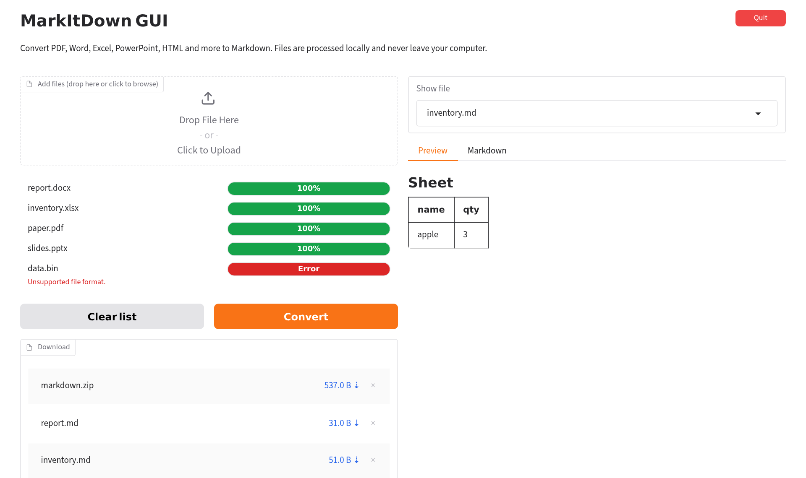

# MarkItDown GUI

[](LICENSE)


A desktop graphical interface for [MarkItDown](https://github.com/microsoft/markitdown), the document-to-Markdown converter. It lets you convert PDF, Word, Excel, PowerPoint and other documents to Markdown without using the command line or installing Python yourself.

> [!NOTE]
> This is an independent, unofficial project. It is not affiliated with, endorsed by, or sponsored by Microsoft. "MarkItDown" refers to the open-source library this application is built on.



## Contents

- [Features](#features)
- [Supported Formats](#supported-formats)
- [Privacy](#privacy)
- [Requirements](#requirements)
- [Installation](#installation)
- [Usage](#usage)
- [Updating and Uninstalling](#updating-and-uninstalling)
- [Troubleshooting](#troubleshooting)
- [Development](#development)
- [Acknowledgements](#acknowledgements)
- [License](#license)
- [Maintainer](#maintainer)

## Features

- **One-click launch** from a desktop or application menu shortcut. Python and all dependencies are installed automatically on first launch.
- **Batch conversion**: add multiple files at once by drag and drop, and keep adding more at any time.
- **Per-file progress**: each file shows its own status, and failures are reported with a reason without stopping the rest of the batch.
- **Preview** the rendered result or the raw Markdown source before saving.
- **Download** individual `.md` files, or all results as a single `.zip` archive.
- **Runs locally**: the interface opens in your web browser, but the application only listens on your own computer (`127.0.0.1`).
- **Stops automatically** when you close the browser tab, or immediately with the **Quit** button.

## Supported Formats

| Category | Extensions |
|---|---|
| Documents | `.pdf`, `.docx`, `.pptx`, `.epub` |
| Spreadsheets | `.xlsx`, `.xls`, `.csv` |
| Email | `.msg` (Outlook) |
| Web and data | `.html`, `.htm`, `.json`, `.xml`, `.ipynb`, `.txt` |
| Archives | `.zip` (each file inside is converted) |

Conversion quality and format support follow the MarkItDown library. Legacy binary Word and PowerPoint files (`.doc`, `.ppt`) are not supported; save them in the newer format first.

Images and audio files are **not** transcribed. MarkItDown can only extract text from them through online services (speech recognition, AI image description), which this application deliberately does not use. See [Privacy](#privacy).

## Privacy

Your files are processed entirely on your own computer.

- The application does not upload files anywhere. Optional MarkItDown features that rely on online services (Azure Document Intelligence, speech-to-text, AI image captioning, YouTube transcripts) are not installed.
- The local web server is bound to `127.0.0.1`, so it cannot be reached from other devices on your network.
- Gradio usage analytics are disabled.
- Uploaded files and conversion results are stored in your system's temporary folder. They are deleted when you click **Quit** or close the browser tab, and files older than one hour are removed while the application is running.

## Requirements

| | Requirement |
|---|---|
| Operating system | Windows 10 or 11, or Ubuntu 22.04 or later (other Linux desktops should work) |
| Disk space | About 1 GB for Python and dependencies, downloaded on first launch |
| Internet | Required for the first launch only, to download dependencies |
| Browser | Any modern browser (Chrome, Edge, Firefox) |

The application uses [uv](https://docs.astral.sh/uv/) to manage Python. If uv is not installed, the launcher offers to install it for you using the official installer.

## Installation

Download the latest source from the green **Code** button on GitHub (**Download ZIP**) and extract it, or clone the repository:

```
git clone https://github.com/junhyeok797/markitdown-gui.git
```

Keep the extracted folder in a permanent location (for example, your Documents folder). The shortcuts point to this folder, so moving it later requires running the install step again.

### Windows

1. Open the extracted folder in File Explorer, right-click an empty area, and select **Open in Terminal**.
2. Run the following command to create **MarkItDown GUI** shortcuts on the desktop and in the Start menu:
   ```
   .\run.bat --install
   ```
3. Double-click the **MarkItDown GUI** shortcut. On first launch, a console window shows the installation progress; this may take a few minutes.

> [!IMPORTANT]
> On Windows 11 with Smart App Control enabled, double-clicking `run.bat` in a downloaded folder is blocked with the message *"Smart App Control blocked a file that may be unsafe."* Step 2 removes the download mark from the application's own files, after which the shortcut runs normally. Administrator rights are not required.

### Ubuntu

1. Open a terminal in the extracted folder.
2. Run the following command to add **MarkItDown GUI** to the application menu and the desktop:
   ```
   bash run.sh --install
   ```
3. Launch **MarkItDown GUI** from the application menu or the desktop icon. On first launch, a notification appears while dependencies are installed; this may take a few minutes.

You can also start the application directly from a terminal with `./run.sh`.

## Usage

1. Launch the application. It opens in your default web browser.
2. Drag files onto the **Add files** area, or click it to choose files. You can add more files at any time.
3. Click **Convert**. Each file shows its progress; failed files are marked in red with the reason.
4. Select a file under **Show file** to preview the result, or open the **Markdown** tab to see the source.
5. Download individual `.md` files or `markdown.zip` from the **Download** list.

Click **Clear list** to start over. Files that have already been converted are not converted again when you add more files.

### Stopping the Application

- Click **Quit** to stop the application and close the tab, or
- Close the browser tab. The application stops automatically about 10 seconds later. Refreshing the page does not stop it.

On Windows, closing the console window also stops the application.

## Updating and Uninstalling

**Updating**: download the new version (or run `git pull`), then run the install command from the [Installation](#installation) section again. Dependencies are updated automatically on the next launch.

**Uninstalling**:

1. Remove the shortcuts:
   - Windows: `.\run.bat --uninstall`
   - Ubuntu: `bash run.sh --uninstall`
2. Delete the application folder.
3. Optionally, remove the downloaded Python environment by running `uv cache clean`. To remove uv itself, see the [uv documentation](https://docs.astral.sh/uv/getting-started/installation/#uninstallation).

## Troubleshooting

| Problem | Solution |
|---|---|
| Windows: "Smart App Control blocked a file that may be unsafe." | Run `.\run.bat --install` from a terminal in the application folder, then use the shortcut. See [Windows installation](#windows). |
| The shortcut stopped working after moving the folder. | Run the install command again from the new location. |
| "uv is required" or uv installation failed. | Install uv manually by following the [official instructions](https://docs.astral.sh/uv/getting-started/installation/), then launch again. |
| The first launch takes a long time. | Python and dependencies (several hundred MB) are being downloaded. Later launches take a few seconds. |
| Ubuntu: nothing happens when clicking the icon. | Check the log at `~/.local/state/markitdown-gui/launch.log`, or run `./run.sh` in a terminal to see the output. |
| A file fails with "No text could be extracted." | The file is an image, audio file, or scanned PDF without a text layer. Text recognition (OCR) and transcription are not supported. |
| The browser did not open. | Open the address printed in the console (usually `http://127.0.0.1:7860`) manually. |

## Development

The entire application is a single script, `app.py`. Its dependencies are declared inline ([PEP 723](https://peps.python.org/pep-0723/)) and pinned in `app.py.lock`.

```bash
uv run app.py                        # run the application
uvx ruff check app.py                # lint
uvx ruff format app.py               # format
uv lock --script app.py              # update the lock file after changing dependencies
uv lock --script app.py --upgrade    # upgrade all dependencies
```

Project layout:

```
markitdown-gui/
├── app.py                  # application (Gradio UI and conversion logic)
├── app.py.lock             # pinned dependency versions
├── run.bat                 # Windows launcher and shortcut installer
├── run.sh                  # Linux launcher and shortcut installer
├── markitdown-gui.desktop  # Linux desktop entry template
├── icon.png / icon.ico     # application icon
└── docs/screenshot.png
```

Contributions are welcome. Please open an issue to discuss significant changes before submitting a pull request, and verify changes on both Windows and Ubuntu where possible.

## Acknowledgements

This project is built on the following open-source software:

- [MarkItDown](https://github.com/microsoft/markitdown) (MIT License): document conversion
- [Gradio](https://github.com/gradio-app/gradio) (Apache License 2.0): user interface
- [uv](https://github.com/astral-sh/uv) (MIT / Apache License 2.0): Python and dependency management

## License

This project is licensed under the [MIT License](LICENSE).

Microsoft is a trademark of the Microsoft group of companies. All other trademarks are the property of their respective owners.

## Maintainer

Maintained by **[junhyeok797](https://github.com/junhyeok797)**.

Bug reports and feature requests can be submitted through [GitHub Issues](https://github.com/junhyeok797/markitdown-gui/issues).
